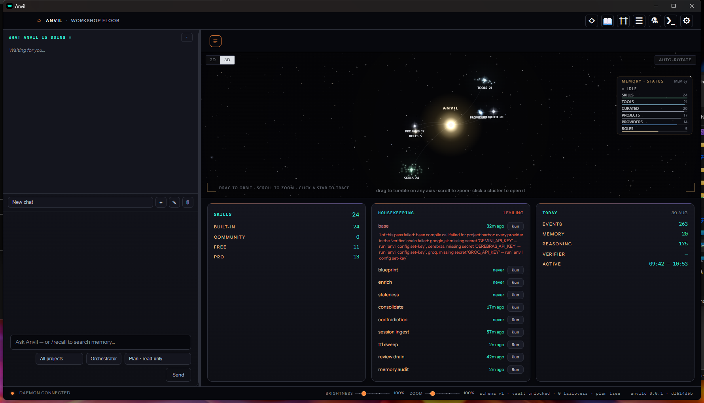
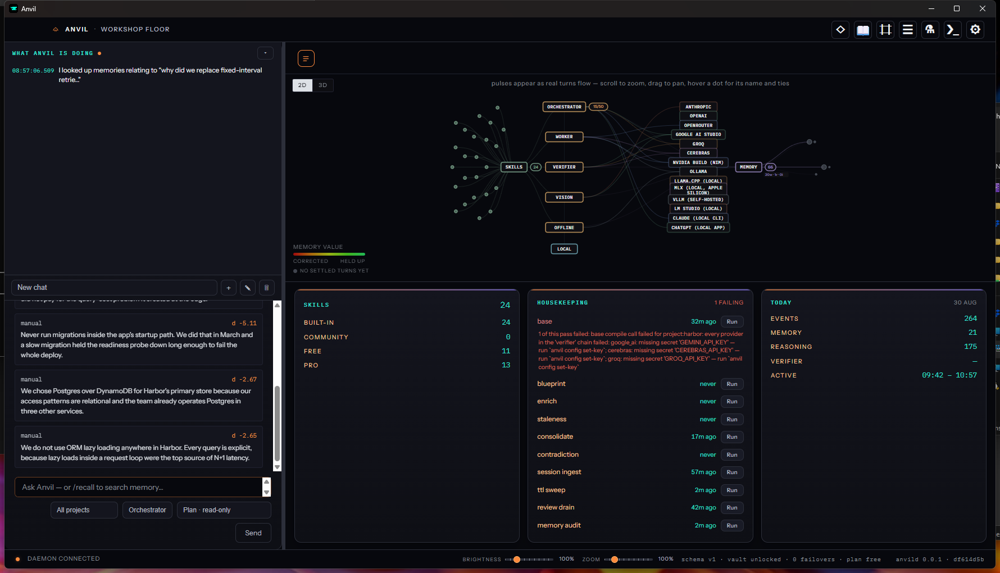
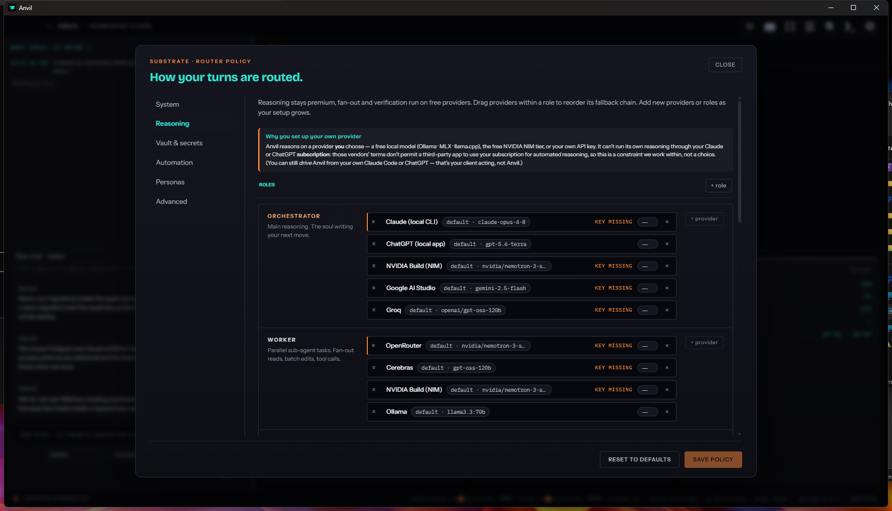
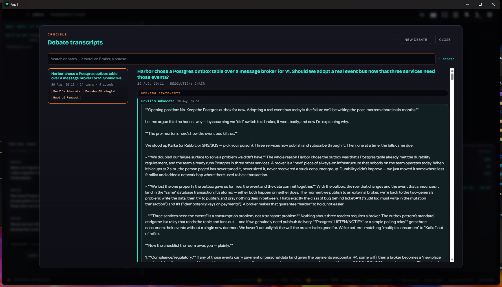
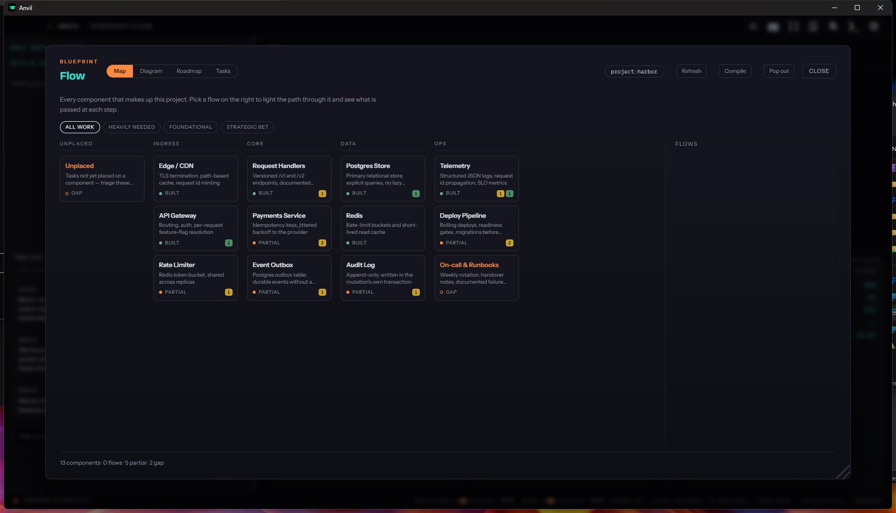

# Anvil

### Your AI has amnesia. I got tired of paying for it.

**A private, local memory-and-reasoning brain that sits underneath the AI you already use.**

[**⬇ Download**](https://github.com/Vitkilabs/anvil-releases/releases/latest) · [**🌐 vitkilabs.com**](https://vitkilabs.com) · [**📖 The full story**](https://vitkilabs.com/blog)

macOS · Windows · Linux — the core memory brain is **free, yours forever.**

*That's not a mockup. It's a real capture of one Anvil brain mid-thought. See the live version at [vitkilabs.com](https://vitkilabs.com).*

---

Here's a small, stupid moment that changed what I've been building.

I was three hours into a hard problem with an AI coding assistant. We'd finally worked out the shape of the thing — the tradeoffs, the dead ends I'd already walked down, the one weird constraint that made the obvious solution wrong. It felt like working with someone sharp.

Then the session ended. And the next morning, it knew none of it. I opened a fresh chat and started re-explaining my own project to a tool that had, the day before, understood it better than most people would. I did that again the day after. And the day after that.

If you've used these tools for real work, you know the feeling. The models are genuinely brilliant — and they have the memory of a goldfish. Every session starts from zero. You become an unpaid narrator, re-reading your own life to a stranger who's very clever and completely new every single morning.

That's the problem Anvil fixes.

## The problem isn't intelligence. It's memory.

We've spent two years making AI *smarter*. Almost nobody made it *remember*. The tools that do offer "memory" mostly bolt on a little cloud key-value store — a handful of facts about you, living on someone else's server. Better than nothing. But it's a sticky note, not a brain.

I wanted the thing to actually *know my work* — and I wanted that knowledge to be **mine**, on my machine, not rented back to me from a cloud I don't control.

## So what is Anvil?

Anvil is a **private, local, structured memory-and-reasoning layer that sits underneath the AI you already use.** It doesn't replace your assistant — it plugs into it. You keep using Claude (and others), signed in the way you already do. Anvil quietly becomes the long-term memory and the sharper reasoning *behind* it.

Three things make it different from a sticky note:

**1. It remembers — properly.** Not a flat list of facts, but a structured knowledge graph: your projects, decisions, and the relationships between them, with the right pieces recalled automatically on every prompt.

**2. It learns from its own work.** When a mistake happens twice, Anvil can turn that lesson into a hard rule it won't cross again, and distills your accumulated work into reusable skills. The system that helped you last month is measurably better this month — because *your* history taught it.

**3. It's yours.** Everything lives on your machine, encrypted. Your memory, your keys, your projects. If your internet drops, a subscription lapses, or a provider has a bad day, Anvil degrades a rung and keeps working. It never bricks — and it's honest with you when something's off instead of pretending everything's fine.

## The part people don't expect

Anvil can convene what I call a **Crucible** — a small cast of characters, each fused with real expertise, who argue a hard question out loud and resolve it to a sharper answer than any single pass would give you. A skeptic. A first-principles thinker. A devil's advocate. They disagree, pressure-test, and converge. It's the difference between asking one clever person and running a decision past a room.

And because a brain you can't see is a brain you can't trust, Anvil **renders its own mind as something you can look at** — a real 3D galaxy where every memory, skill and project is a star you can fly through. When it's thinking, you can watch it think.

## It knows your project, not just your chat

Anvil keeps a live map of what you're building — components, status, and the tasks attached to each — so the assistant reasons about your *actual system*, not just the last thing you pasted.

## Download

The core memory brain is **free — not a crippled trial, the actual brain, yours to keep.** Create an account only when you want to move up to Pro.

> **[⬇ Grab the latest release →](https://github.com/Vitkilabs/anvil-releases/releases/latest)**

| Platform | File | First-launch note |
|---|---|---|
| **macOS** (Apple Silicon) | `Anvil_*_aarch64.dmg` | Right-click → **Open** (notarisation coming). |
| **macOS** (Intel) | `Anvil_*_x64.dmg` | Right-click → **Open**. |
| **Windows** | `Anvil_*_x64.msi` | **More info → Run anyway** (signing coming). |
| **Linux** | `.deb` / `.rpm` / `.AppImage` | `sudo apt install ./*.deb`, or `chmod +x` the AppImage. |

Prefer Homebrew? `brew install vitkilabs/anvil/anvil` — no Gatekeeper prompts.

Full instructions and the ongoing story live at **[vitkilabs.com](https://vitkilabs.com)**.

---

Built under **[Vitkilabs](https://vitkilabs.com)** by a builder who hit this wall hard enough, often enough, to stop complaining and start soldering.

*Anvil™ is a product of Vitkilabs. Runs fully offline — nothing leaves your machine.*

